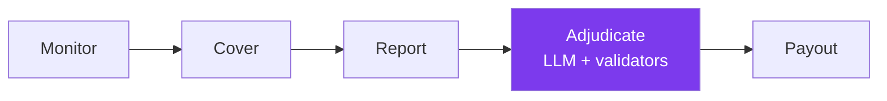

<div align="center">

# 🛰️ Watchtower

### Slashing Monitoring & Insurance on GenLayer

*Protocols get watched. Violations get proven by validator consensus. Victims get paid — no committee, no paperwork.*

[](https://docs.genlayer.com/)
[](https://nextjs.org/)
[](https://www.python.org/)
[](./LICENSE)

[Live Demo](#-frontend) · [How it works](#-how-it-works) · [Smart Contract](#-intelligent-contract) · [Test Report](#-test-report)

</div>

---

## What is this?

**Watchtower** is a slashing-monitoring and insurance system built on [GenLayer](https://docs.genlayer.com/) — the adjudication layer where **Intelligent Contracts** combine Python smart contracts with LLM reasoning, live web access, and decentralized validator consensus.

The problem with classic slashing/insurance is trust: who decides a violation really happened? An oracle committee? A multisig? Watchtower replaces them with **GenLayer validator consensus over live web evidence**:



1. **Monitor** — a protocol registers on-chain with written slash conditions + evidence sources.
2. **Cover** — users pay a GEN premium into the shared pool and receive a policy.
3. **Report** — anyone reports a suspected violation with an evidence URL.
4. **Adjudicate** — anyone triggers evaluation: validators independently fetch the evidence, an LLM judges it against the slash conditions, consensus settles the verdict.
5. **Payout** — holders of confirmed violations claim from the pool, then withdraw.

## ✨ Highlights

- **Judgment, not just code** — LLM validators read evidence like investigators (double-signs, downtime, SLA breaches).
- **Live web, no oracle** — the contract fetches evidence itself at decision time.
- **Consensus with teeth** — a leader proposes, validators independently re-verify; disagreement rotates leadership instead of locking in a bad call. Every evaluation receipt exposes per-validator votes in the UI's *Consensus proof* panel.
- **Insurance pool accounting** — premiums in, payouts out, claimable balances, all on-chain.
- **EVM wallet login** — EIP-6963 popup (MetaMask, Rabby, …) with zero injection racing, plus instant burner identity fallback.

## 🧠 Intelligent Contract

`contracts/watchtower_insurance.py` — `WatchtowerInsurance` (pinned runner `py-genlayer:1jb45…`)

| Method | Access | Description |
|---|---|---|
| `register_protocol` | owner | Register a monitored protocol + slash conditions |
| `set_protocol_active` | owner | Pause / resume coverage for a protocol |
| `purchase_coverage` | anyone, **payable** | Pay GEN premium → policy issued, pool grows |
| `report_incident` | anyone | File a violation report with evidence URL |
| `evaluate_incident` | anyone | LLM + web consensus verdict (`confirmed_violation` / `rejected`) |
| `payout_claim` | policy holder | Claim coverage against a confirmed incident |
| `withdraw` | anyone | Withdraw own claimable balance |
| `get_*` / `list_*` | anyone | Pool, protocols, policies, incidents, claimables |

**Consensus design** (`run_nondet_unsafe` + custom validator): the validator re-runs the whole evidence-fetch + LLM task and compares only the decision fields (`violation`, `payout_eligible`, `severity`) — reasoning text may differ. Errors are classified (`[EXPECTED]` / `[TRANSIENT]` / `[LLM_ERROR]`) so validators agree on deterministic failures and retry on flaky ones.

> **Live on studionet:** `0x75a82361b32DFE26aFA481c7FB93a692517f21F7`

## 🧪 Test Report

| Suite | Result | Notes |
|---|---|---|
| `genvm-lint` | ✅ pass | 15 methods (8 view + 7 write) |
| Direct tests (`pytest tests/direct/`) | ✅ **6/6** | Logic + mocked web/LLM, ~ms each |
| Integration (`gltest`, studionet, real GenVM) | ✅ **7/7** | Register → buy → report → **real LLM evaluate** → payout → withdraw, plus revert gates |
| Browser E2E (headless Chromium) | ✅ **4/4** | Landing → protocols → report → evaluate + consensus panel, against live chain |

## 🖥️ Frontend

Next.js 15 + TypeScript + Tailwind v4 + shadcn-style `components/ui` + `genlayer-js`, dark-first night-ops aesthetic with an interactive GridPulse hero.

| Route | Purpose |
|---|---|
| `/` | Hero, live pool stats, How-it-works, CTAs |
| `/protocols` · `/protocols/[id]` | Monitored protocols, slash conditions, policy tables |
| `/coverage` | Buy policy in whole GEN (auto ×10¹⁸) |
| `/incidents` · `/incidents/[id]` | Report, trigger evaluation, verdict + consensus votes |
| `/claims` | Payout claim + withdraw |

```bash
cd frontend
npm install
npm run dev      # http://localhost:3000
```

Deploying to Vercel? Set **Root Directory** to `frontend` — no env vars needed.

## 🛠️ Contract Development

```bash
pip install -r requirements.txt

# lint (always first)
genvm-lint check contracts/watchtower_insurance.py

# fast unit tests, no server
pytest tests/direct/ -v

# full consensus tests (needs localnet/GLSim or studionet)
gltest tests/integration/ -v -s --network studionet

# deploy with the project wallet (keystore stays outside the repo)
python deploy/deploy_watchtower.py --network studionet
```

## 📁 Structure

```
contracts/                    # WatchtowerInsurance intelligent contract
tests/direct/                 # In-memory unit tests (mocked web/LLM)
tests/integration/            # Consensus tests (studionet GenVM)
deploy/                       # Keystore-based deploy script
frontend/                     # Next.js dApp (app router + genlayer-js)
  app/                        # /, /protocols, /coverage, /incidents, /claims
  components/ui/              # shadcn-style primitives + GridPulse
  lib/                        # genlayer client, EIP-6963 wallets, GEN format
```

## 🔐 Notes

- The deployer keystore lives **outside this repo** and is never committed (see `.gitignore`).
- Studionet is a test network — premiums and payouts use test GEN (faucet via the 💧 button in [Studio](https://studio.genlayer.com/)).
- `evaluate_incident` needs live web evidence; unreachable evidence deterministically yields `rejected`.

## 📚 Links

- [GenLayer docs](https://docs.genlayer.com/) · [GenLayerJS](https://docs.genlayer.com/api-references/genlayer-js) · [Studio](https://studio.genlayer.com/)
- [Contract in Studio](https://studio.genlayer.com/contracts/0x75a82361b32DFE26aFA481c7FB93a692517f21F7)

## License

MIT — see [LICENSE](./LICENSE).
</div>
